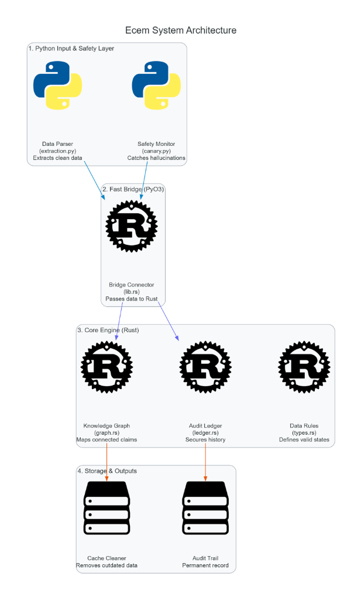

# ecem

High-performance epistemic graph engine, cryptographic provenance ledger, and runtime entropy monitoring for structured LLM pipelines.

ecem bridges high-throughput Rust graph execution and lattice-based state invalidation with Python runtime safety monitors. It provides real-time hallucination canary detection via token entropy and an immutable SHA-256 audit ledger for LLM-generated decision graphs.

---

## Table of Contents

- [Key Features](#key-features)
- [Architecture Overview](#architecture-overview)
- [Execution Flow](#execution-flow)
- [Prerequisites](#prerequisites)
- [Quickstart](#quickstart)
  - [1. Environment Setup](#1-environment-setup)
  - [2. Build Native Extension](#2-build-native-extension)
- [Usage Example](#usage-example)
  - [Causal Graph and Cryptographic Ledger](#causal-graph-and-cryptographic-ledger)
  - [Runtime Entropy Canary](#runtime-entropy-canary)
- [Testing](#testing)
- [CI / CD Pipelines](#ci--cd-pipelines)

---

## Key Features

- **Directed Acyclic Graph & Invalidation Engine**: Built with petgraph in Rust to maintain epistemic dependency graphs and cascade cache invalidation efficiently.
- **Cryptographic Provenance Ledger**: Tamper-evident, hash-chained transaction ledger (sha2) tracking node lineage, edge transitions, and execution histories.
- **Lattice-Based Type System**: Formal lattice enums and edge semantics for monotonic information updates and confidence bounds.
- **Normalized Token Entropy Canary**: Real-time runtime monitor measuring prediction uncertainty and detecting anomalous token drift.
- **Structured Extraction Pipeline**: First-class support for schema extraction directly into graph nodes.
- **Zero-Overhead Bindings**: Compiled with PyO3 and packaged via Maturin for native execution speed in Python environments.

---

## Architecture Overview



```text
ecem/
├── crates/ecem_core/             # Native Rust engine
│   ├── src/graph.rs              # petgraph Directed Graph & Invalidation Engine
│   ├── src/ledger.rs             # Cryptographic provenance ledger (SHA-256)
│   ├── src/types.rs              # Lattice enums, node & edge definitions
│   └── src/lib.rs                # PyO3 Python extension bindings
└── python/ecem/                  # Python API and orchestration
    ├── extraction.py             # Schema parsing helpers
    └── canary.py                 # Normalized token entropy runtime monitor
```

---

## Execution Flow

1. **Extraction**: Structured outputs are parsed from LLM payloads into strongly typed schemas (`ecem.extraction`).
2. **Entropy Canary**: Inflight token log probabilities are evaluated against entropy thresholds to detect divergence or hallucination bursts (`ecem.canary`).
3. **Graph Ingestion**: Validated extractions are converted into lattice node states within `ecem.CausalGraphEngine`.
4. **Invalidation & Ledgering**: Any updated or refuted upstream state triggers topological invalidation cascades, and all modifications are signed into the append-only ledger (`ecem.Ledger`).

---

## Prerequisites

- **Python**: 3.10 or higher
- **Rust**: Pinned stable toolchain (configured via `rust-toolchain.toml`)
- **Build Backend**: `maturin >= 1.4`

> Note: On Windows, compiling the PyO3 crate requires the Microsoft C++ Build Tools (MSVC) workload installed via the Visual Studio Installer.

---

## Quickstart

### 1. Environment Setup

Clone the repository and set up a virtual environment:

```bash
# Clone the repository
git clone https://github.com/vivinarya/ecem.git
cd ecem

# Create and activate virtual environment
python -m venv .venv
source .venv/bin/activate  # On Windows: .venv\Scripts\Activate.ps1

# Install development toolchain
pip install --upgrade pip maturin pre-commit pytest ruff mypy
```

### 2. Build Native Extension

Compile the Rust core crate and install it directly into your virtual environment:

```bash
# Debug build (fast compilation)
maturin develop

# Release build (maximum performance)
maturin develop --release
```

> Note: Run `pre-commit install` to register local git hooks for formatting (rustfmt, ruff) and linting (clippy).

---

## Usage Example

### Causal Graph and Cryptographic Ledger

```python
from ecem import (
    CDGNode,
    CausalGraphEngine,
    EdgeType,
    EntityType,
    Ledger,
    NodeState,
)

# Initialize cryptographic provenance ledger and graph engine
ledger = Ledger()
graph = CausalGraphEngine()

# Insert typed decision graph nodes
root_node = CDGNode(
    id="claim_1",
    entity_type=EntityType.Decision,
    name="context_window",
    content="Model context window is 128k",
    turn_created=1,
    status=NodeState.VALID,
)

child_node = CDGNode(
    id="claim_2",
    entity_type=EntityType.Decision,
    name="batch_size",
    content="Batch fit confirmed",
    turn_created=2,
    status=NodeState.VALID,
)

graph.insert_node(root_node)
graph.insert_node(child_node)

# Connect dependency edge and record in ledger
graph.add_dependency_edge("claim_2", "claim_1", EdgeType.DependsOn)
ledger.record_transition("state_hash_turn_2")

# Invalidate upstream node and cascade through dependents
replacement_node = CDGNode(
    id="claim_1_v2",
    entity_type=EntityType.Decision,
    name="context_window",
    content="Model context window is 64k",
    turn_created=3,
)

invalidated = graph.mutate_and_cascade("claim_1", replacement_node, turn_id=3)
print(f"Nodes invalidated: {invalidated}")
```

### Runtime Entropy Canary

```python
from ecem.canary import EntropyCanary

# Initialize canary monitor with an entropy threshold
canary = EntropyCanary(threshold=0.65, window_size=5)

# Stream logprobs during LLM generation
token_logprobs = [-0.05, -0.12, -0.85, -2.40, -3.10]
for token, logprob in zip(["The", "answer", "is", "uncertain", "data"], token_logprobs):
    status = canary.step(logprob)
    if status.triggered:
        print(
            f"Anomaly detected at token '{token}': normalized entropy = {status.entropy:.4f}"
        )
```

---

## Testing

Run native Rust unit tests and Python integration tests:

```bash
# Run Rust core tests
cargo test --workspace

# Run Python integration test suite
pytest tests/ -v

# Validate pre-commit hooks across the repository
pre-commit run --all-files
```

---

## CI / CD Pipelines

- **CI (`.github/workflows/ci.yml`)**: Executes cargo clippy, rustfmt, Python unit and integration test matrices on all pull requests.
- **Release (`.github/workflows/release.yml`)**: Uses maturin-action to build wheels across Linux (manylinux), macOS, and Windows for multi-architecture deployment.